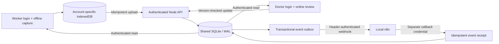

# Shared-care architecture

Server tables: users, sessions, patients, events, automation_receipts, audit, settings and meta. SQLite's database lives in `.local/drishti.sqlite`; no database or credential file is served as a public asset. Static serving uses a public-directory boundary and rejects symlinks outside it.

New screenings and their outbox events are committed in one transaction. Health workers cannot submit trusted review fields. Doctors save versioned reviews while online; stale writes return HTTP 409. The user keeps their form draft and can refresh the shared record before retrying.

Worker device records use a stable ID; retry after an ambiguous upload response returns the existing record only for the originating worker. Offline data is scoped by server instance and user. v0.1 data remains in its original database until explicitly imported as screenings.

The server retries pending n8n deliveries every 15 seconds. A callback receipt has a unique event ID. A crash after receipt acceptance but before outbox acknowledgment may rerun the workflow; receipt insertion is idempotent. External actions such as SMS must add separate idempotency handling. The webhook excludes names, phone numbers, histories and photographs.

Security baseline: scrypt password hashing; SHA-256 hashes of random session tokens; HttpOnly SameSite cookies; CSRF tokens for session writes; origin checks; a 12-hour absolute expiry; login throttling; fixed server roles; private integration settings and separate automation credentials. The local setup binds to loopback, uses HTTP, and does not encrypt SQLite or browser caches. These are synthetic-demo boundaries, not a clinical production approval.

## Android, intake and consultation extensions

Android bundles public UI files under a fixed local HTTPS origin and uses a route-limited Java bridge to the configured backend. Session cookies are Android Keystore encrypted; WebView patient data is still an unencrypted local cache for synthetic use. Native camera/gallery and speech intents feed the same form workflow. A separate video activity has camera/microphone permissions and no patient API bridge.

Saathi is a local state machine over seven intake fields. Answers are validated, drafts are account scoped, and consent/submission remain user actions. No medical model or LLM diagnosis is claimed.

The consultations table stores requested appointments. Doctor creation and a consultation.requested event are transactional. The separate authenticated n8n workflow returns an event-specific Jitsi URL to a protected callback; only that callback changes the appointment to ready. A unique receipt prevents duplicate callback rows. Ready means link prepared, not a connected call.

Administrator bulk provisioning validates a complete batch before committing accounts. New passwords are randomly generated and asynchronously hashed. Login hashing is asynchronous, and per-account/IP throttling avoids one shared ten-attempt bucket across the team. A temporary Cloudflare Quick Tunnel exposes only the app. Permanent account/domain routing remains pending a real hostname and browser authorization. It tunnels the existing host; there is no Workers/D1 migration or demonstrated mass-load capacity.

## Research inference and structured care

Doctor-only research inference sends the already uploaded image to a local Python subprocess. The weights are separately downloaded, revision pinned, checksum checked and loaded using safe weights-only PyTorch with strict architecture matching. Model status comes from an actual load check, cached for one minute. The process has a bounded timeout and output size, and one inference request runs at a time. The output contains the raw model-card class and provenance, never a clinical probability, automatic diagnosis or care-stage change. The doctor must explicitly acknowledge authorized adult research use. A record-version recheck after inference prevents overwriting concurrent care changes. No photo is sent to an external AI service.

Diagnostic, treatment and follow-up entries are append-only within the versioned shared patient body. Each includes title, facility, date, planned/completed/missed status, clinician notes and optional scanned image. Doctor role and CSRF are required. Per-image, per-record attachment and entry limits bound storage; PDF/HTML uploads are not accepted. Structured entries add a care.updated outbox event containing stage/village only, not report images or notes. The dashboard aggregates these entries and labels activity separately from epidemiological prevalence. Existing patient data and credentials are preserved.
