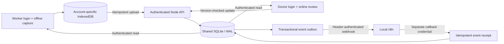

# Shared-care architecture

Server tables: users, sessions, patients, events, automation_receipts, audit, settings and meta. SQLite's database lives in `.local/drishti.sqlite`; no database or credential file is served as a public asset. Static serving uses a public-directory boundary and rejects symlinks outside it.

New screenings and their outbox events are committed in one transaction. Health workers cannot submit trusted review fields. Doctors save versioned reviews while online; stale writes return HTTP 409. The user keeps their form draft and can refresh the shared record before retrying.

Worker device records use a stable ID; retry after an ambiguous upload response returns the existing record only for the originating worker. Offline data is scoped by server instance and user. v0.1 data remains in its original database until explicitly imported as screenings.

The server retries pending n8n deliveries every 15 seconds. A callback receipt has a unique event ID. A crash after receipt acceptance but before outbox acknowledgment may rerun the workflow; receipt insertion is idempotent. External actions such as SMS must add separate idempotency handling. The webhook excludes names, phone numbers, histories and photographs.

Security baseline: scrypt password hashing; SHA-256 hashes of random session tokens; HttpOnly SameSite cookies; CSRF tokens for session writes; origin checks; a 12-hour absolute expiry; login throttling; fixed server roles; private integration settings and separate automation credentials. The local setup binds to loopback, uses HTTP, and does not encrypt SQLite or browser caches. These are synthetic-demo boundaries, not a clinical production approval.
